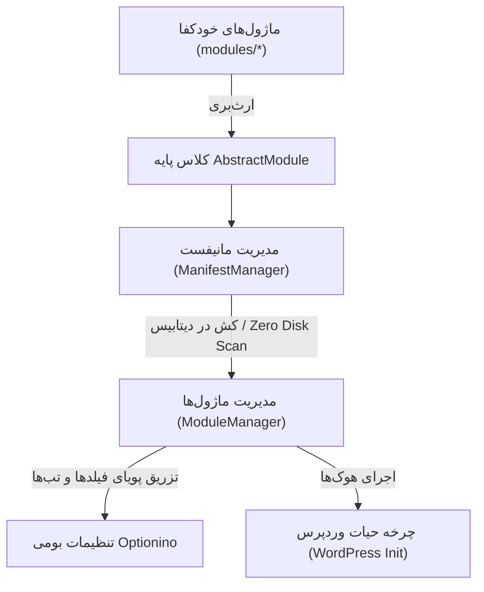

# 📐 مستند و راهنمای جامع توسعه ماژول‌ها (MODULE_RULES.md)
## 📌 افزونه ماژولار سینگو (Singo Modular Architecture)

این سند مرجع فنی و راهنمای استاندارد برنامه‌نویسی برای ساخت و افزودن ماژول‌های جدید به **افزونه ماژولار سینگو** است. تمامی ماژول‌ها در این معماری به صورت **خودکفا (Self-Contained)**، مستقل و بدون نیاز به دستکاری فایل‌های هسته افزونه یا فریم‌ورک Optionino طراحی می‌شوند.

---

## 🏛️ ۱. ارکان اصلی معماری ماژولار

معماری این افزونه از ۴ لایه به هم پیوسته تشکیل شده است:



1. **`AbstractModule` (`includes/Core/AbstractModule.php`):** کلاس پایه انتزاعی که هر ماژول باید از آن ارث‌بری کند.
2. **`ManifestManager` (`includes/Core/ManifestManager.php`):** کاشف خودکار ماژول‌ها در زمان نصب، ارتقا یا بروزرسانی و کش‌کننده دائمی ساختار ماژول‌ها در دیتابیس.
3. **`ModuleManager` (`includes/Core/ModuleManager.php`):** نمونه‌ساز و کنترل‌کننده فعال/غیرفعال بودن ماژول‌ها در زمان اجرای وردپرس.
4. **`Optionino` (`optionino/`):** فریم‌ورک رابط کاربری پنل مدیریت (۱۰۰٪ Read-Only و دست‌نخورده).

---

## 📂 ۲. ساختار پوشه‌بندی هر ماژول

هر ماژول باید درون یک پوشه اختصاصی با شناسه ماژول (`kebab-case`) در مسیر `modules/` مستقر شود:

```
modules/my-custom-module/
├── MyCustomModule.php          # فایل کلاس اصلی (نام StudlyCaps + Module.php)
├── assets/                     # دارایی‌های لوکال (CSS / JS / Images)
└── includes/                   # کلاس‌ها و فایل‌های کمکی داخلی ماژول
```

---

## 🧭 ۳. قوانین جای‌گذاری در پنل تنظیمات (Module Placement)

هر ماژول بسته به وسعت تنظیمات خود، یکی از دو استراتژی زیر را برای جای‌گذاری در پنل انتخاب می‌کند:

### حالت اول: ماژول با تب اختصاصی (`dedicated_tab`)
برای ماژول‌های بزرگ یا چندبخشی (مانند ماژول نمونه **تاریخ شمسی**).
- **متد `get_placement()`:** برگرداندن `'dedicated_tab'` (یا عدم تعریف متد، چون پیش‌فرض همین است).
- **متد `get_order()`:** تعیین اولویت نمایش تب (مثلاً `10`, `20`, `30`).
- **متد `get_optionino_tab()`:** برگرداندن ساختار تب با آرایه `fields`.

```php
public static function get_placement(): string {
    return 'dedicated'; // پیش‌فرض AbstractModule
}

public static function get_order(): int {
    return 10;
}

public function get_optionino_tab(): ?array {
    return array(
        'id'     => self::get_id(),
        'title'  => self::get_name(),
        'icon'   => self::get_icon(),
        'fields' => array(
            // فیلدهای Optionino
        ),
    );
}
```

### حالت دوم: ماژول سبک در تب سایر امکانات (`other_tools`)
برای ماژول‌های تک‌منظوره یا سبک (مانند ماژول نمونه **زمان تخمینی مطالعه**).
- **متد `get_placement()`:** برگرداندن مقدار صریح `'other_tools'`.
- **متد `get_optionino_fields()`:** برگرداندن آرایه فیلدهای ماژول.
- **رفتار خودکار هسته:** هسته افزونه تمام فیلدهای این ماژول‌ها را در یک تب مشترک به نام **«سایر امکانات»** با اولویت آخر (`PHP_INT_MAX`) تجمیع می‌کند. اگر هیچ ماژولی در این تب نباشد، تب به صورت خودکار کاملاً حذف می‌شود.

```php
public static function get_placement(): string {
    return 'other_tools';
}

public function get_optionino_fields(): array {
    return array(
        array(
            'id'      => 'enable_my_feature',
            'type'    => 'switcher',
            'title'   => self::get_name(),
            'desc'    => 'توضیحات عملکرد قابلیت.',
            'default' => false,
        ),
    );
}
```

---

## ⚡ ۴. سیاست عدم اسکن دیسک در ران‌تایم (Zero Disk Scanning)

> [!IMPORTANT]
> در هر لود صفحه وردپرس (Front-end یا Back-end)، هیچ فایلی از دیسک اسکن یا خوانده نمی‌شود (`glob`, `scandir` ممنوع).

- فهرست ماژول‌های موجود در دیتابیس در کلید `singo_modular_modules_manifest` کش می‌شود.
- بازسازی مانیفست صرفاً در شرایط زیر انجام می‌گیرد:
  1. هنگام فعال‌سازی افزونه (`register_activation_hook`).
  2. هنگام ارتقا و آپدیت افزونه (`upgrader_process_complete`).
  3. هنگام ذخیره تنظیمات در پنل ادمین.
- برای فراخوانی فایل‌ها یا آدرس‌ها داخل ماژول، صرفاً از متدهای خودکفا استفاده شود:
  ```php
  $css_file = $this->get_path( 'assets/style.css' );
  $css_url  = $this->get_url( 'assets/style.css' );
  ```

---

## 🔒 ۵. قانون وضعیت اولیه غیرفعال (Default Inactive Rule)

> [!CRITICAL]
> **تمامی قابلیت‌ها و ماژول‌های جدید باید به صورت پیش‌فرض در حالت غیرفعال (`false`) باشند.**
> 
> - مقدار فیلد سوئیچر در Optionino: `'default' => false`
> - متد `is_enabled()`:
>   ```php
>   public static function is_enabled(): bool {
>       return (bool) singo_modular_get_option( 'my_module_switch', false );
>   }
>   ```
> - کاربر باید پس از نصب به صفحه تنظیمات رفته و قابلیت مورد نظر را به اختیار خود روشن کند.

---

## 🐘 ۶. استانداردهای کدنویسی

1. **PHP 8+ Strict Typing:** ابتدای تمامی فایل‌های PHP بدون استثنا:
   ```php
   <?php
   declare(strict_types=1);
   ```
2. **Type Hinting دقیق:** تمامی متغیرهای ورودی و خروجی متدها باید نوع مشخص داشته باشند (`: void`, `: string`, `: bool`, `: array`, `: ?array`, `: self`).
3. **عدم ویرایش هسته Optionino:** پوشه `optionino/` کاملاً **Read-Only** است.
4. **تایپوگرافی ارث‌بری‌شده:** در تمامی استایل‌های ادمین و فرانت از `font-family: inherit !important;` استفاده شود.
