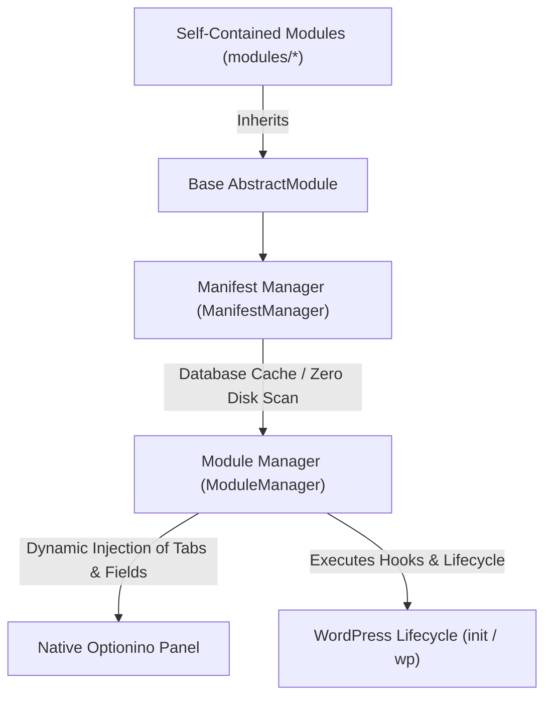

# 📐 Comprehensive Module Development Specification (MODULE_RULES.md)
## 📌 Singo Modular Architecture

This document serves as the official technical reference and standard coding guideline for authoring and integrating new modules into **Singo Modular**. All modules within this framework are architected to be **Self-Contained**, fully decoupled, and require zero modifications to the core plugin files or the Optionino framework.

---

## 🏛️ 1. Architectural Pillars

The modular framework is constructed of four interconnected layers:



1. **`AbstractModule` (`includes/Core/AbstractModule.php`):** The abstract contract that every module must extend.
2. **`ManifestManager` (`includes/Core/ManifestManager.php`):** Discovers modules upon activation, update, or settings save and caches module metadata permanently in the database.
3. **`ModuleManager` (`includes/Core/ModuleManager.php`):** Responsible for instantiating enabled modules and orchestrating their runtime execution.
4. **`Optionino` (`optionino/`):** Admin panel UI framework (100% read-only and unmodified).

---

## 📂 2. Module Directory Structure

Each module must reside in its own dedicated directory in `modules/`, named using `kebab-case`:

```
modules/my-custom-module/
├── MyCustomModule.php          # Main module class (StudlyCaps + Module.php)
├── assets/                     # Module assets (CSS / JS / Images)
└── includes/                   # Internal helper classes and sub-components
```

---

## 🧭 3. Admin Panel Placement Rules

Depending on the complexity and scope of the settings, each module selects one of two placement strategies:

### Strategy A: Dedicated Tab (`dedicated_tab`)
Ideal for large or multi-section modules (e.g., the bundled **Solar Hijri Date** module).
- **Method `get_placement()`:** Returns `'dedicated_tab'` (or omitted, as this is the default in `AbstractModule`).
- **Method `get_order()`:** Determines tab position priority (e.g., `10`, `20`, `30`).
- **Method `get_optionino_tab()`:** Returns the tab schema definition array with an internal `fields` array.

```php
public static function get_placement(): string {
    return 'dedicated_tab';
}

public static function get_order(): int {
    return 10;
}

public function get_optionino_tab(): ?array {
    return array(
        'id'     => self::get_id(),
        'title'  => self::get_name(),
        'icon'   => self::get_icon(),
        'fields' => array(
            // Optionino field definitions
        ),
    );
}
```

### Strategy B: Lightweight Feature in "Other Tools" Tab (`other_tools`)
Ideal for single-purpose utilities or compact tools (e.g., the bundled **Estimated Reading Time** module).
- **Method `get_placement()`:** Returns `'other_tools'`.
- **Method `get_optionino_fields()`:** Returns an array of field definitions.
- **Automatic Core Behavior:** The core consolidates all fields from `other_tools` modules into a unified tab titled **"Other Tools"** positioned at the end (`PHP_INT_MAX`). If no modules use this strategy, the tab is automatically omitted.

```php
public static function get_placement(): string {
    return 'other_tools';
}

public function get_optionino_fields(): array {
    return array(
        array(
            'id'      => 'enable_my_feature',
            'type'    => 'switcher',
            'title'   => self::get_name(),
            'desc'    => 'Toggle this feature on or off.',
            'default' => false,
        ),
    );
}
```

---

## ⚡ 4. Zero Disk Scanning Runtime Policy

> [!IMPORTANT]
> On every WordPress page request (both frontend and backend), no filesystem scanning (`glob`, `scandir`) is permitted.

- The registry of active modules is cached in the WordPress database under the option `singo_modular_modules_manifest`.
- Manifest rebuilding is strictly confined to lifecycle triggers:
  1. Plugin activation hook (`register_activation_hook`).
  2. Plugin upgrade completion (`upgrader_process_complete`).
  3. Settings panel save operations.
- To resolve file paths or URLs within a module, use the built-in helper methods:
  ```php
  $css_file = $this->get_path( 'assets/style.css' );
  $css_url  = $this->get_url( 'assets/style.css' );
  ```

---

## 🔒 5. Default-Inactive Principle

> [!CRITICAL]
> **All new modules and features must be disabled by default (`false`).**
> 
> - Switcher field definition in Optionino: `'default' => false`
> - Method `is_enabled()`:
>   ```php
>   public static function is_enabled(): bool {
>       return (bool) singo_modular_get_option( 'my_module_switch', false );
>   }
>   ```
> - Administrators must explicitly opt-in and toggle features on from the settings panel.

---

## 🐘 6. Development & Coding Standards

1. **PHP 8+ Strict Typing:** Every PHP file must declare strict types at line 1:
   ```php
   <?php
   declare(strict_types=1);
   ```
2. **Strict Type Hinting:** All method arguments and return types must be explicitly declared (`: void`, `: string`, `: bool`, `: array`, `: ?array`, `: self`).
3. **Immutability of Optionino Core:** The `optionino/` folder is strictly **Read-Only**.
4. **Inherited Admin Typography:** All admin panel styles must use `font-family: inherit !important;` to respect the active dashboard font.
